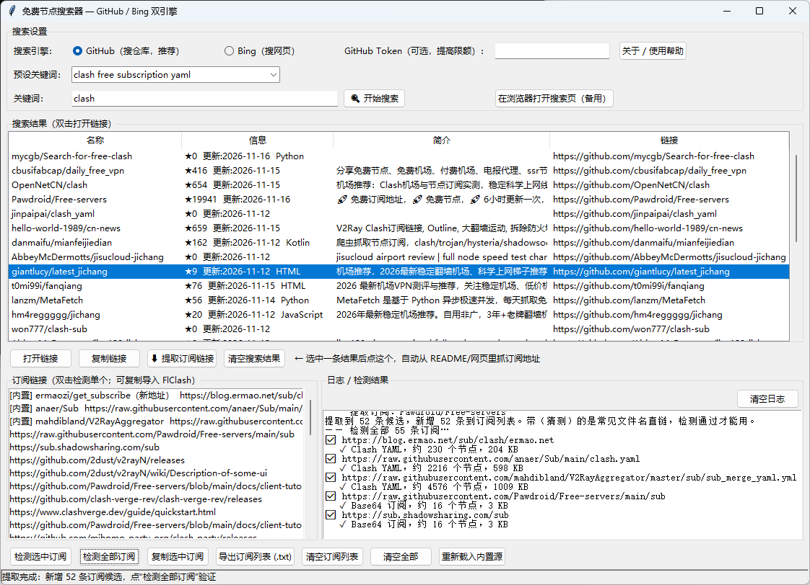

# 免费节点搜索器（GitHub / Bing 双引擎）

> 开发作者：**mycgb** ｜ 程序右上角点「关于 / 使用帮助」可查看完整的上手流程、按钮说明和常见问题。

一个零依赖的 Python 桌面小工具：帮你从 GitHub 和 Bing 上找免费的 Clash / V2Ray 订阅节点，
把订阅链接提取出来、逐条检测能不能用，再复制导入 FlClash 等客户端。

## 界面预览

  

> 桌面版主界面：上方选择引擎与关键词，中间是搜索结果（双击可打开仓库/网页），左下是提取出的订阅链接，
> 右下是逐条检测日志。没有 tkinter 的环境会自动切换成功能一致的浏览器界面。

## 运行方法（Windows）

1. 确认电脑装了 Python 3.8+（没装去 python.org 下载，安装时勾选 **Add Python to PATH**）
2. 双击 `run.bat`（推荐），或在本文件夹打开命令行运行 `python node_searcher.py`

不需要 pip 安装任何东西，只用 Python 标准库。

### 启动出错怎么办（已内置自动修复）

- **原报错：`ModuleNotFoundError: No module named 'tkinter'`** —— 有些精简版 / 嵌入式 Python 不带 tkinter。现在程序会自动处理：
  1. `run.bat` 先找出一个**能运行**的 Python（PATH → `py -3` → 常见安装目录），不再写死 `python`；
  2. 若这个 Python 没有 tkinter，主程序会扫描本机其它 Python，找到带 tkinter 的就用它**自动重启桌面窗口**；
  3. 一个带 tkinter 的都没有时，**自动切换为浏览器界面**：只监听 `127.0.0.1`，默认打开 `http://127.0.0.1:8765/`（端口占用会自动顺延），关闭黑色命令行窗口即退出。
- 浏览器界面功能与桌面版一致：GitHub / Bing 搜索、提取订阅链接、逐条检测、复制、导出 .txt，内置源自动载入。
- `run.bat` 保持纯 ASCII 且不使用 `call/goto` 子过程，避免中文 Windows 的 CMD 代码页把批处理命令解析坏；启动失败时窗口会停住并显示具体错误，不再一闪而过。
- 想强制使用浏览器界面（不重启桌面版）：设置环境变量 `NODE_SEARCHER_RELAUNCH=1` 后运行。

### 编码问题（CMD 中文乱码 / `'锘?` 之类报错）

中文 Windows 的 CMD 用 **936(GBK)** 代码页解析 `.bat`，所以：

- `run.bat` 必须保持 **纯 ASCII + CRLF 换行 + 无 BOM**，并且**不要加 `chcp 65001`**。UTF-8 BOM、LF-only 换行、中文注释都会让 CMD 截断命令；中途切换代码页又会和 Python 的 stdout 编码冲突，把中文输出变成乱码。
- 因此控制台输出（`run.bat` 的 `echo` 与 `node_searcher.py` 的 `print`）**一律只用英文 ASCII**；中文只留在 Tk 窗口、浏览器页面（HTTP 明确 `charset=utf-8`）和本 README 里——这三处都不受 CMD 代码页影响。
- 用记事本 / 编辑器改过 `run.bat` 后如果又报错，先检查是否被另存成了 UTF-8 BOM 或 LF 换行。建议始终双击 `run.bat`，不要手动设 `PYTHONIOENCODING`。

## 使用流程

1. **选引擎**：GitHub（用官方 API 搜仓库，结果准、带星数和更新时间）或 Bing（搜网页，范围广）
2. **选/填关键词**：有 8 个预设，如 `clash free subscription yaml`、`get_subscribe clash`、`免费节点 clash yaml 每日更新`，也可以自己改
3. **点“开始搜索”** → 结果出现在中间列表，双击可打开仓库/网页
4. **选中一条结果 → 点“提取订阅链接”** → 程序自动抓它 README / 网页里的订阅地址（含常见文件名猜测，带“猜测”标记）
5. **点“检测全部订阅”** → 逐条请求验证：只有返回标准 Clash YAML（含 `proxies:` 和节点）或 Base64 节点订阅的才算 ✅，并显示约有多少个节点；返回网页、404 的会标 ❌ 并说明原因
6. **复制选中订阅** → 粘贴到 FlClash：配置 → 新建 → 从 URL 导入

## 内置源

启动时订阅列表里自带 3 条公开源，2026-11-16 打包当天实测可用：
ermaozi 官方新地址（约 172 节点；注意它仓库根目录的老 `clash.yml` 已下线、会 404）、anaer/Sub（约 2163 条 name 记录）、mahdibland/V2RayAggregator。
免费源随时可能失效，用之前先点“检测全部订阅”确认。

## 小提示

- GitHub 未登录搜索限额约 10 次/分钟，被限流（HTTP 403）时等一分钟，或在界面右上角填自己的 GitHub Token 提高限额。Token 不要发给任何人。
- 检测通过 ≠ 节点个个能连：订阅文件有效只说明格式对，具体节点速度还要导入客户端后测延迟。
- 只导入检测为 ✅ 的 `.yaml/.yml` 标准订阅；`.txt` 的 IP 优选列表不是 Clash 订阅，导不进 FlClash。
- 免费节点来历不明，不要用来登录重要账号、网银等敏感操作。
- 清空类按钮分四种（桌面版 / 浏览器版一致）：「清空日志」只清右侧检测结果记录、「清空搜索结果」只清中间列表、「清空订阅列表」只清订阅列表；底部「清空全部」一键清掉三者，会先弹确认框防误删。清空订阅后点「重新载入内置源」即可恢复内置源。

## 文件说明

- `node_searcher.py` — 主程序（单文件，桌面窗口 + 浏览器界面双模式）
- `run.bat` — Windows 双击启动（自动挑 Python、失败保留错误窗口）
- `docs/screenshot.png` — 界面截图（本说明里的界面预览）
- `.gitignore` / `.gitattributes` — 忽略本地工具数据、固定 `run.bat` 为 CRLF
- `README.md` — 本说明
